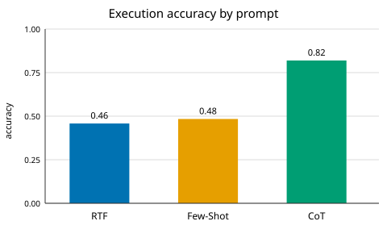
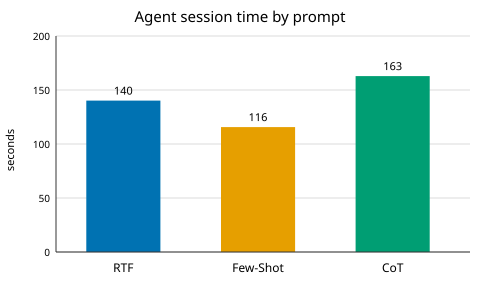

# Task 2 Report

| prompt | correct/155 | accuracy | time (s) | model |
|---|---|---|---|---|
| rtf | 71 | 45.81% | 140.1 | gpt-5.6-luna |
| fewshot | 75 | 48.39% | 115.7 | gpt-5.6-luna |
| cot | 127 | 81.94% | 162.9 | gpt-5.6-luna |

## Comparison
- Highest score: CoT (127). Shortest run: FewShot (116s).
- Reported seconds span the full session per prompt, not individual queries.
- 155 went unreached by every prompt; Q65 is not a restaurant question.
- Each prompt ran once with no repair loop, so scores reflect the single-pass output as written.
