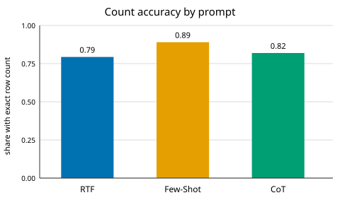
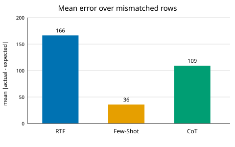

# Task 3 Report

## Definition
Per question: `err = |actual_count − expected_count|` (net row-count difference; content-blind by design). Per prompt:
- **Count-accuracy** = share of all 155 with `err == 0`.
- **Wrong-median / wrong-mean** = median / mean of `err` over exact-mismatch rows only (correct rows excluded).

Computed from `Task_2/results_*.csv` count columns only.

| prompt | count-acc | wrong-median | wrong-mean | n wrong |
|---|---|---|---|---|
| rtf | 79.35% | 0 | 166.4 | 84/155 |
| fewshot | 89.03% | 0 | 35.7 | 80/155 |
| cot | 81.94% | 1 | 109.2 | 28/155 |

## Why this metric fits
The assignment scores 0/1: a one-row slip gets the same 0 as a miss by thousands.
This metric keeps the size of the miss.
A one-row slip, a loose filter, and a query returning thousands of rows land far apart instead of tied.
- Wrong-median 0 (RTF/FewShot): their usual miss returns the right number of rows but the wrong ones.
  CoT's 1: its usual miss is off by one row.
- Wrong-mean flips the ranking (FewShot < CoT < RTF): one giant miss counts more when split over few fails.

## Complements, not replaces
Counting rows can't tell which rows came back.
RTF/FewShot often get the count right with the wrong rows — full marks here, 0 there.
So read both: FewShot counts best (89%) but retrieves worse (75 exact); CoT gets 81.94% on both, so its counts and rows stand or fall together.

## Reproduce
`python3 Task_3/metric.py` (reads `Task_2/results_*.csv` → `metric.json`, figs).
