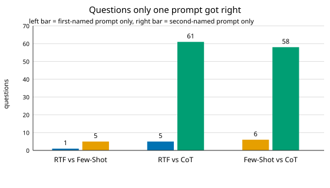

# Task 4 Report

Scores from Task 2 (exact accuracy) and Task 3 (count calibration).
Model `gpt-5.6-luna` for all three prompts.

| prompt | exact | count-acc | wrong-median | wrong-mean |
|---|---|---|---|---|
| rtf | 71/155 (45.81%) | 79.35% | 0 | 166.4 |
| fewshot | 75/155 (48.39%) | 89.03% | 0 | 35.7 |
| cot | 127/155 (81.94%) | 81.94% | 1 | 109.2 |

## Are the gaps real?
For each pair we throw out questions where both prompts agreed and keep only the ones exactly one got right. Then we ask: if both prompts were equally good, how often would a fair coin produce a split this lopsided? Small chance means a real difference. Adjusted for testing 3 pairs at once.[^1]

| pair | only-A | only-B | chance | real difference |
|---|---|---|---|---|
| RTF vs Few-Shot | 1 | 5 | 1 in 4.6 | no |
| RTF vs CoT | 5 | 61 | 1 in 1e+12 | yes |
| Few-Shot vs CoT | 6 | 58 | 1 in 6e+10 | yes |

RTF and FewShot are basically tied: 4 rows apart, nearly the same count numbers, and a 1-vs-5 split coins make all the time. Both CoT gaps are far beyond luck.

## Why the differences look this way
- **Prompts.** CoT spells out the tables and double-checks filters, and pulls far ahead — the design can't say which of those two ingredients matters more. RTF is bare structure and FewShot adds examples for +4 (not significant), so examples alone moved nothing measurable here.
- **Model.** Same model all three times, so it can't explain any gap.
- **Coding agent.** One pass per prompt, no fixing rounds. CoT's leftover misses are small and scattered; Q65 was missed by all three.

## Limits
- One run per prompt, so the small RTF-vs-FewShot gap sits inside run noise — the coin check agrees.
- We didn't run any fixing rounds; scores would differ if agents were allowed to repair via the checker, since repairs change both accuracy and what the wording itself accounts for.

[^1]: Exact McNemar test with Holm correction; `statistics.json` holds the raw numbers.

## Reproduce
`python3 Task_4/analyze.py` reads `Task_2/results_*.csv` and writes `statistics.json` plus `figs/discordant.svg`.
