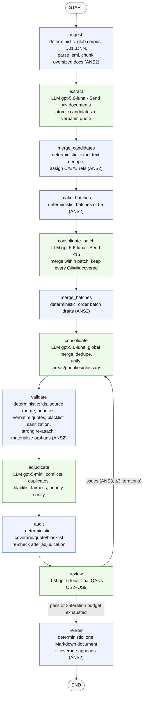

# Task 1 Report — Agentic Network for Requirements Refinement

## What was built

A LangGraph network that ingests a directory of heterogeneous texts (draft SRS,
email threads, interviews, meeting minutes, a survey) and emits a single structured
requirements document with unique IDs, tracing, priorities, a glossary, a blacklist
of discarded candidates, and a coverage appendix.

| File | Role |
|---|---|
| `shell.nix` | nix shell providing `python3`, `langgraph`, and `langchain-openai` from the nixpkgs flake registry |
| `ingest.py` | deterministic corpus loader (doc IDs, `.eml` thread parsing, chunking) |
| `agent_network.py` | the agentic network: state, LLM nodes, deterministic nodes, graph, CLI |
| `check_output.py` | deterministic OS1–OS9 checker over the produced document + state |
| `output/requirements.md` | the generated requirements specification (71 requirements) |
| `output/state.json` | full intermediate state (candidates, batch drafts, review log) for auditing |
| `data/smoke/` | 2-document mini corpus for cheap end-to-end smoke tests |

Run: `nix-shell --impure --run "python agent_network.py --input data/corpus --output output"`
(the `--input` path is an arbitrary argument — nothing is hard-coded; `OPENAI_API_KEY`
is read from the environment or `Task_1/.env`). The included artifacts are from
that full run followed by the deterministic pass
`python agent_network.py --audit-state output/state.json --output output`, which
re-grounds quotes, rebuilds the blacklist, and closes any candidate coverage gap
without another LLM call.

## Network design

### Spec coverage

| Spec | Where it is addressed |
|---|---|
| ANS1 ≥3 agentic nodes | `extract`, `consolidate_batch`, `consolidate`, `adjudicate`, `review` (5 LLM node definitions) |
| ANS2 ≥1 deterministic node | `ingest`, `merge_candidates`, `make_batches`, `merge_batches`, `validate`, `audit`, `render` |
| ANS3 ≥1 feedback loop | `review → consolidate` conditional edge driven by the reviewer verdict + deterministic `validate` issues injected into the same loop; capped at 3 iterations |
| ANS4 ≥3 different models | `gpt-5.6-luna` (extraction + consolidation), `gpt-5-mini` (adjudication), `gpt-6-luna` (review) |
| ANS5 LangGraph | `StateGraph` with typed state, `Send` map-reduce fan-out, conditional edges |
| OS1 single document | `render` produces one Markdown spec with fixed section structure |
| OS2 unique IDs | `validate` assigns `REQ-###` positionally — uniqueness is guaranteed by code, not by the model |
| OS3 no duplicates | aggressive-merge prompt at batch + global level; second-opinion duplicate detection by adjudicator and reviewer feeds the loop; `check_output.py` verifies no duplicate or near-duplicate names |
| OS4 tracing | every requirement carries `sources: [{doc_id, quote, cands}]`; `validate` drops unknown doc ids; reviewer + checker verify every requirement cites the corpus |
| OS5 name + paragraph | prompt requires ≤8-word name and 2–4 sentence paragraph; checker verifies ≥15 words of explanation |
| OS6 priority scale | fixed P1–P4 scale defined in prompts, rendered as a legend, normalized by `validate` (aliases like "high" → P2), checked deterministically |
| OS7 consistency | glossary produced by consolidation and unified globally; glossary and keywords support shared vocabulary; conflicts detected by adjudicator/reviewer; checker verifies glossary presence |
| OS8 completeness | per-candidate tracking: every `C####` must land in a requirement or the blacklist; `validate` re-attaches only semantically matching dropped refs, then `audit` materializes any remaining unmatched candidate as a small grounded requirement; coverage appendix maps every document to the requirements citing it |
| OS9 blacklist | conflicting/nonsensical/superseded candidates are moved to a blacklist with reasons; untraceable requirements are deterministically demoted there too; section rendered with category + reason |

## Design choices and rationale

1. **Hierarchical map-reduce consolidation.** The corpus yields 851 raw
   candidates (820 after exact-text dedupe). A single LLM pass either truncated
   coverage (first attempt: 20 requirements, 542 uncovered candidates) or
   collapsed into unreviewable mega-requirements (15 requirements, ~50 candidates
   each). The two-level design (per-batch merge of ≤55 candidates → global merge
   of 350 batch-draft requirements) keeps every prompt/output within comfortable
   token budgets while preserving per-candidate provenance.
2. **IDs and normalization are code, not prompts.** Models are forbidden from
   assigning ids; `validate` numbers requirements, merges duplicate source
   citations per requirement, normalizes priority aliases, and demotes
   untraceable statements to the blacklist. Uniqueness (OS2) and priority enum
   integrity (OS6) therefore hold even from a weak model.
3. **Candidate-ref ledger for completeness.** Every merged candidate keeps a
   `C####` ref that batch consolidation must place exactly once. A ref the global
   consolidator drops is re-attached only when it shares at least two content
   terms with an existing requirement; otherwise the audit materializes it as a
   small requirement grounded in its original document and verbatim quote. Both
   repairs are deterministic, so coverage cannot silently drift while avoiding
   the earlier failure mode of bulk-attaching every orphan to an unrelated
   requirement.
4. **Four-layer quality control feeding one loop.** Deterministic `validate`
   (hard invariants) → LLM `adjudicate` (fairness/consistency second opinion on a
   cheap model) → deterministic `audit` (re-checks coverage, quotes and blacklist
   after the adjudicator's edits) → LLM `review` (spec-level QA on the strongest
   model). All issues are concatenated into the next `consolidate` revision,
   which must return a full revised spec (3 iterations max, then best-effort
   render).
5. **Robust LLM plumbing.** Tolerant JSON extraction (fence stripping + balanced
   brace scan), one repair re-ask on parse failure, exponential-backoff retries,
   `temperature` auto-dropped for `gpt-6-*` (the endpoint rejects non-default
   temperature), per-document extraction failures degrade to notes instead of
   crashing the run.
6. **Token economy.** Extraction fan-out is parallel and per-document;
   consolidation input is slimmed (explanations truncated to 350 chars, compact
   JSON separators); reviewer payloads cap explanations at 600 chars and
   adjudicator ones at 400; the review→consolidate loop is capped at 3.
   Deterministic repairs (ref re-attachment, source merging) fix whole classes of
   issues without additional LLM calls; `--dry-run` and `data/smoke/` allow
   verifying wiring before spending API quota.

## Result on the provided corpus

- 20 documents → 851 raw candidates → 820 unique candidates → 15 batches →
  350 batch-draft requirements → 62 consolidated requirements.
- The deterministic post-run audit found 12 candidate refs the consolidator had
  omitted. Nine of them were materialized as small grounded requirements (the
  four IntraPINES loan variants merged into one), giving **71 final requirements**
  (P1: 13, P2: 45, P3: 13), 1 blacklist entry, 27 glossary terms, and 46 unique
  area sections.
- All 20 documents are cited by ≥1 requirement; 0 uncovered candidate refs;
  requirement ids unique; every requirement has a source, name, paragraph and
  priority; every quote is verbatim (`check_output.py`: **21/21 checks pass**).
- The gpt-6-luna reviewer never returned a full pass within the 3-iteration
  budget. Its residual findings are true spec-level weaknesses rather than
  structural failures: 26 requirements still absorb more than 12 candidate refs
  (the largest has 44), and it flags some overlap/conflict between broad
  reporting and accessibility requirements. These are recorded in section 7 of
  `output/requirements.md` and in the `audit_issues`/`review_issues` fields of
  `output/state.json`. Per the assignment, each OS spec is addressed by a network
  element even where the underlying model output is not perfect.

## How the models were used

| Node | Model | Why |
|---|---|---|
| `extract`, `consolidate_batch`, `consolidate` | `gpt-5.6-luna` | selected for extraction and hierarchical consolidation, where recall and careful merging matter most |
| `adjudicate` | `gpt-5-mini` | independent second opinion on a separate model; catches conflicts/duplicates the consolidator missed without consuming review-model calls |
| `review` | `gpt-6-luna` | final spec-level QA driving the feedback loop; used once per iteration |

`gpt-6-luna` rejects `temperature=0` (API constraint), so temperature is only
sent to `gpt-5*` models; the client retries without temperature if a new model
complains.
