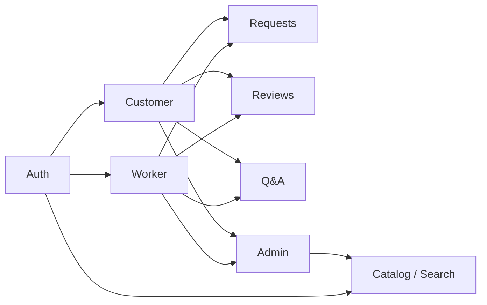
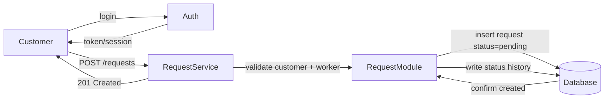

# ADR 001: Choose a modular monolith for RentYourExpert

- Status: Accepted
- Date: 2026-10-28

## Context

RentYourExpert is a marketplace platform that connects customers with expert workers. It must support three primary roles:

- Customer
- Worker
- Admin

The system requirements include registration and login, profile management, worker catalog browsing, request creation and tracking, worker accept/reject flows, Q&A, reviews, and admin moderation. The business logic is heavily workflow-driven and role-sensitive, and the system must maintain consistency across requests, reviews, questions, and authorizations.

Because the platform is still in its early stage, the dominant design concern is business correctness and delivery speed, not large-scale distributed processing.

## Decision

We will build RentYourExpert as a modular monolith with a single shared relational database and clearly separated internal modules.

### Internal modules

- Auth module: login, registration, logout, role checks, session management
- Customer module: customer profiles and personal request history
- Worker module: worker profiles, skills, location, and profile management
- Request module: request lifecycle states and worker/customer actions
- Review module: create, update, delete, and moderation of reviews
- Q&A module: customer questions and worker answers
- Admin module: moderation and operational management across the platform
- Catalog/Search module: worker discovery by location and skill

### Module responsibility table

| Module | Primary responsibility | Key entities |
| --- | --- | --- |
| Auth | Login, registration, role validation | users, sessions, roles |
| Customer | Customer profile and personal history | customer_profiles, requests, reviews |
| Worker | Worker profile and expertise data | worker_profiles, worker_skills |
| Request | Workflow for renting expertise | requests, request_status_history |
| Review | Ratings and feedback | reviews |
| Q&A | Questions and answers | questions, answers |
| Admin | Moderation and operational control | admin_actions, moderation_logs |
| Catalog/Search | Worker discovery and filtering | worker_profiles, worker_skills, search index |

### Core domain relationship table

| Entity | Related to | Relationship |
| --- | --- | --- |
| users | customer_profiles, worker_profiles | one-to-one profile records |
| customer_profiles | requests, reviews, questions | customer owns content and actions |
| worker_profiles | requests, reviews, questions, answers | worker receives content and handles work |
| requests | customers and workers | service request between both parties |
| reviews | customers and workers | customer rating of worker performance |
| questions | customers and workers | customer asks, worker answers |
| answers | questions and workers | worker response to customer question |

### Architectural diagram: layered modular monolith

```mermaid
flowchart TD
    UI[Web UI / Mobile UI / Admin Dashboard]
    APP[Application Layer\nAuth | Customer | Worker | Request | Review | Q&A | Admin | Catalog/Search]
    DOMAIN[Domain / Business Services\nRole checks | Workflow rules | Permissions]
    DB[(Shared Relational Database)]

    UI --> APP
    APP --> DOMAIN
    DOMAIN --> DB
```

### Module relationship diagram



### Proposed database schema (core tables)

```text
users
- id (PK)
- email
- password_hash
- role
- created_at
- updated_at

customer_profiles
- id (PK)
- user_id (FK -> users.id)
- full_name
- phone
- location
- bio
- created_at
- updated_at

worker_profiles
- id (PK)
- user_id (FK -> users.id)
- full_name
- headline
- location
- bio
- rating_avg
- created_at
- updated_at

worker_skills
- id (PK)
- worker_id (FK -> worker_profiles.id)
- skill_name
- experience_years

requests
- id (PK)
- customer_id (FK -> customer_profiles.id)
- worker_id (FK -> worker_profiles.id)
- title
- message
- status
- created_at
- updated_at

request_status_history
- id (PK)
- request_id (FK -> requests.id)
- previous_status
- new_status
- changed_by_user_id (FK -> users.id)
- changed_at

reviews
- id (PK)
- customer_id (FK -> customer_profiles.id)
- worker_id (FK -> worker_profiles.id)
- rating
- comment
- created_at
- updated_at

questions
- id (PK)
- customer_id (FK -> customer_profiles.id)
- worker_id (FK -> worker_profiles.id)
- question_text
- created_at
- updated_at

answers
- id (PK)
- question_id (FK -> questions.id)
- worker_id (FK -> worker_profiles.id)
- answer_text
- created_at
- updated_at

admin_actions
- id (PK)
- admin_id (FK -> users.id)
- entity_type
- entity_id
- action
- created_at

moderation_logs
- id (PK)
- actor_id (FK -> users.id)
- entity_type
- entity_id
- reason
- created_at
```

### Sequence diagram: customer creates a request



### Sequence diagram: worker accepts a request

```mermaid
flowchart LR
    W[Worker] -->|login| A[Auth]
    A -->|token/session| W
    W -->|PATCH /requests/{id}/accept| RS[RequestService]
    RS -->|verify ownership| RM[RequestModule]
    RM -->|update status=accepted| DB[(Database)]
    DB -->|confirm success| RM
    RM -->|record status history| DB
    RS -->|200 OK| W
```

### Basic API breakdown

| Module | Endpoint examples | Purpose |
| --- | --- | --- |
| Auth | POST /auth/register, POST /auth/login, POST /auth/logout | create users and manage sessions |
| Customer | GET /customers/{id}, PUT /customers/{id}, GET /customers/{id}/requests | customer profile and history |
| Worker | GET /workers, GET /workers/{id}, GET /workers/{id}/reviews | catalog and worker detail |
| Request | POST /requests, GET /requests/{id}, PATCH /requests/{id}/accept, PATCH /requests/{id}/reject | request lifecycle |
| Review | POST /reviews, PUT /reviews/{id}, DELETE /reviews/{id} | customer feedback operations |
| Q&A | POST /questions, POST /questions/{id}/answers, GET /workers/{id}/questions | questions and answers |
| Admin | GET /admin/customers, GET /admin/workers, DELETE /admin/reviews/{id} | moderation and admin actions |
| Catalog | GET /catalog?skill=...&location=... | worker discovery |

## Rationale

A modular monolith is the best fit because the product is mostly a transactional marketplace with clear business flows, not a system that obviously requires independent service scaling at the start.

This approach gives us:

- simpler deployment and maintenance
- easier debugging and testing
- strong transactional consistency across domain operations
- clearer role-based authorization rules
- faster MVP delivery

## Alternatives Considered

### 1. Domain-oriented microservices

Pros:
- clear service boundaries
- team autonomy
- independent scaling

Cons:
- more infrastructure and deployment complexity
- distributed transactions and eventual consistency issues
- harder debugging and slower delivery for a smaller team
- more operational overhead than the project needs right now

### 2. Serverless / BFF with search-first catalog

Pros:
- good for bursty traffic
- strong read-heavy search capability
- more elastic scaling for peak events

Cons:
- more complex auth and data consistency patterns
- index synchronization issues
- cold starts and latency variation
- harder to reason about for a workflow-heavy product

## Consequences

### Positive

- fast path to a correct first version
- fewer moving parts than microservices
- consistent enforcement of permission rules
- easier start for a small team

### Negative

- code can become tightly coupled without discipline
- large module growth may require refactoring later
- search performance may need optimization as traffic grows

## Implementation Notes

- Keep each domain module responsible for one business area.
- Use one relational database as the system of record.
- Enforce authorization in the domain layer, not only in the UI.
- Model request lifecycle explicitly with status transitions.
- Use read-optimized indexes or a separate search layer only when performance requires it.
- Define a clear domain boundary for each module so that customer, worker, request, review, Q&A, and admin logic do not cross-contaminate one another.
- Use a service layer or application layer behind controllers to coordinate use cases such as creating a request, accepting a request, adding a review, or answering a question.
- Use a shared database schema with table ownership by domain: users, profiles, workflows, content, and moderation.
- Add optimistic locking or versioning for sensitive workflow transitions such as request accept/reject to avoid race conditions.
- Include audit columns such as created_by, created_at, updated_at, and deleted_at where relevant to support moderation and traceability.
- Make authorization rules explicit at the action boundary, for example: customer may only edit their own review, worker may only accept their own requests, admin may moderate all content.
- Treat the catalog/search module as a read-optimized projection of worker data rather than the system of record.
- Keep this monolith modular even though it is one deployable application; the goal is clean ownership and future extraction, not spaghetti code.

## Future Evolution

If the project scales substantially later, the modular monolith can evolve gradually by extracting the catalog/search functionality or splitting out high-traffic modules. This preserves early simplicity without locking the architecture into a poor long-term fit.

## Summary

The chosen architecture is a modular monolith because it best matches RentYourExpert’s early-stage business needs: transactional workflow management, clear role boundaries, and strong consistency with lower operational overhead than distributed alternatives.
