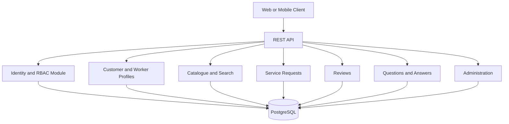
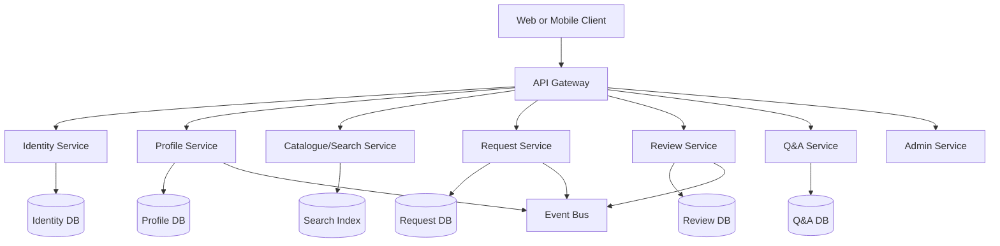
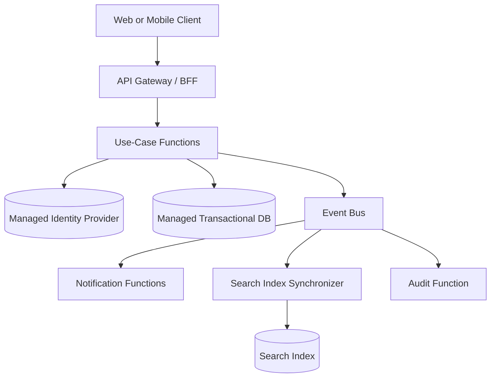
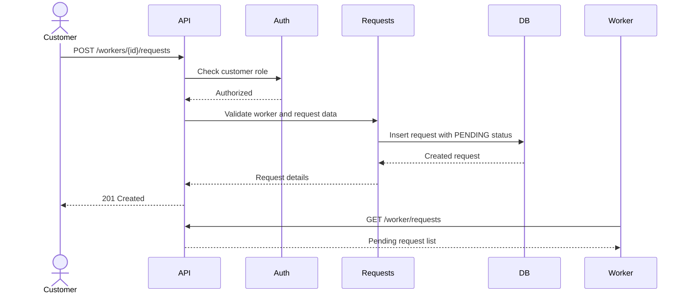

# RentYourExpert Architecture Discussion Record

## User Request

Read the requirements and propose 3 architectures.

## Agent Response

## Requirements Analysis

RentYourExpert is a **transactional, role-based service marketplace**. Its primary actors are:

| Actor | Main responsibilities |
|---|---|
| Customer | Register/login, browse workers, inspect profiles and reviews, create/delete requests, ask questions, submit/update/delete reviews, manage profile |
| Worker | Register/login, manage profile and skills, view requests, accept/reject requests, answer questions |
| Admin | Manage customers, workers, requests, reviews, questions, and answers |

Important business flows are:

1. **Identity and authorization:** customers, workers, and admins authenticate and receive permissions appropriate to their role.
2. **Worker discovery:** customers search the worker catalogue by skills and location.
3. **Request lifecycle:** a customer creates a request, the worker accepts or rejects it, and the customer can view or delete it.
4. **Q&A:** customers ask questions on worker pages; the relevant worker answers; both are visible according to moderation rules.
5. **Reviews:** customers read worker reviews and can create, update, or delete their own review; admins can moderate reviews.
6. **Administration:** admins manage users and marketplace content.

The system is primarily transactional and workflow-heavy. Correct ownership checks and consistent request/review state are more important initially than independent scaling.

## Candidate Architecture 1: Modular Monolith



### Responsibilities and boundaries

- **Identity:** credentials, password hashing, sessions/JWTs, roles, and authorization policies.
- **Profiles:** customer and worker data, skills, locations, and profile updates.
- **Catalogue:** worker visibility and filtering by skill/location.
- **Requests:** request creation, ownership, status transitions, and deletion rules.
- **Reviews:** one customer’s reviews, ownership checks, worker review listing, and moderation.
- **Q&A:** questions, worker answers, ownership, and cascading moderation deletion.
- **Administration:** privileged management operations and audit records.

### Advantages

- Strong relational transactions for request status and review ownership.
- Simple deployment, debugging, testing, and local development.
- Shared authorization and database constraints reduce consistency risks.
- Clear internal modules can later become independent services.

### Costs and risks

- Modules share the same deployment and database.
- Poor module boundaries could produce a tightly coupled codebase.
- A high-volume search operation may compete for resources with transactional operations.

### Fit

Best fit for the current requirements and likely project stage. The system has many related CRUD operations but no stated requirement for massive traffic, multi-team ownership, or independent deployment.

## Candidate Architecture 2: Domain-Oriented Microservices



Each service owns its data and exposes APIs for its domain. Events such as `RequestCreated`, `RequestAccepted`, `WorkerUpdated`, and `ReviewSubmitted` update read models, notifications, or audit logs.

### Advantages

- Independent deployment and scaling.
- Strong domain ownership and team autonomy.
- Search can use a dedicated index without affecting transactional storage.
- Failure isolation is better than in a monolith.

### Costs and risks

- More infrastructure: gateway, service discovery, observability, deployment automation, and event broker.
- Cross-service authorization and data ownership are harder.
- Operations involving several domains require eventual consistency or distributed workflow handling.
- Local development and integration testing become substantially more complex.

### Fit

Appropriate only if the platform grows substantially, requires independent scaling, or is maintained by multiple teams. It is over-engineered for the stated initial scope.

## Candidate Architecture 3: Serverless Backend-for-Frontend with Events



Functions are organized around use cases such as registration, profile updates, worker search, request creation, request decisions, review management, Q&A, and administration. The transactional database remains the source of truth; events handle notifications, audit logging, and search synchronization.

### Advantages

- Automatic scaling and low server-management overhead.
- Natural support for asynchronous notifications and indexing.
- Individual use cases can be deployed independently.
- Suitable for irregular traffic.

### Costs and risks

- Eventual consistency between the transactional database and search index.
- Distributed tracing and end-to-end testing are more difficult.
- Provider-specific services can create vendor lock-in.
- Function boundaries, retries, and duplicate events require careful design.

### Fit

Good for a small team operating in a cloud environment, but less suitable than a modular monolith for the first implementation because the core workflows require simple, observable transactions.

## Comparison

| Criterion | Modular Monolith | Microservices | Serverless/Event-Driven |
|---|---:|---:|---:|
| Initial implementation effort | Low | High | Medium |
| Operational complexity | Low | Very high | Medium |
| Request/review consistency | Strong | Difficult across services | Strong locally, eventual across events |
| Independent scaling | Limited | Excellent | Excellent |
| Search extensibility | Medium | Excellent | Excellent |
| Debugging and testing | Simple | Difficult | Moderate |
| Fit for current project | Excellent | Weak | Good |

## Selected Architecture: Modular Monolith

The modular monolith is selected because it provides the best balance of correctness, implementation effort, and future evolution. The request lifecycle, review ownership, role-based authorization, and administrative deletion rules can be enforced with one transactional database and one consistent security boundary.

### Recommended initial components

```text
Frontend:       React, Vue, or Angular
Backend:        REST API with a layered modular design
Database:       PostgreSQL
Authentication: Secure sessions or short-lived JWT access tokens
Authorization:  Role-based and resource-ownership policies
Search:         PostgreSQL indexes initially; external search later if needed
Deployment:     Docker-based deployment
```

### Initial schema ideas

- `users(id, email, password_hash, role, status, created_at)`
- `customer_profiles(user_id, name, contact_details)`
- `worker_profiles(user_id, bio, location, availability)`
- `skills(id, name)` and `worker_skills(worker_id, skill_id)`
- `service_requests(id, customer_id, worker_id, description, status, created_at)`
- `reviews(id, customer_id, worker_id, request_id, rating, text, created_at)`
- `questions(id, customer_id, worker_id, text, status, created_at)`
- `answers(id, question_id, worker_id, text, created_at)`
- `audit_events(id, actor_id, action, resource_type, resource_id, created_at)`

Database constraints should enforce unique emails, valid request statuses, review ownership, and foreign-key relationships. Deleting a question should use an explicit transaction or foreign-key cascade to remove its answers.

### Request creation flow



## Architecture Decision Record

### Context

RentYourExpert needs role-based access, worker search, request workflows, reviews, Q&A, and administrative moderation. These features share users, ownership rules, and transactional state.

### Decision

Implement the first version as a modular monolith backed by PostgreSQL. Separate the backend into domain modules with explicit interfaces and shared authorization policies. Use database indexes for initial skill/location search and introduce a dedicated search index only when performance requires it.

### Alternatives Considered

1. **Domain-oriented microservices:** strongest independent scaling, but introduces unnecessary distributed-system complexity at the current stage.
2. **Serverless/event-driven BFF:** attractive for cloud scaling and asynchronous work, but complicates debugging and consistency for the initial transactional workflows.

### Consequences

**Positive**

- Faster implementation and simpler deployment.
- Strong consistency for requests, reviews, and ownership checks.
- Easier automated testing and debugging.
- Clear modules preserve a path to future extraction.

**Negative**

- The whole application is deployed together.
- Resource-heavy search could affect the main application if not indexed or later separated.
- Teams must preserve module boundaries to avoid a tightly coupled monolith.

### Implementation Notes

Use centralized authentication middleware, role policies, and resource-level checks. Treat the request status transitions as an explicit state machine: `PENDING -> ACCEPTED`, `PENDING -> REJECTED`, and optionally `PENDING -> CANCELLED`. Permit customers to modify only their own profile, requests, and reviews; permit workers to modify only their own profile and answer questions addressed to them; permit admins to moderate all managed resources.

### Future Evolution

Extract the catalogue/search module first if read traffic increases, followed by notifications and possibly requests. Publish internal domain events from the beginning so that these extractions do not require redesigning every workflow.
