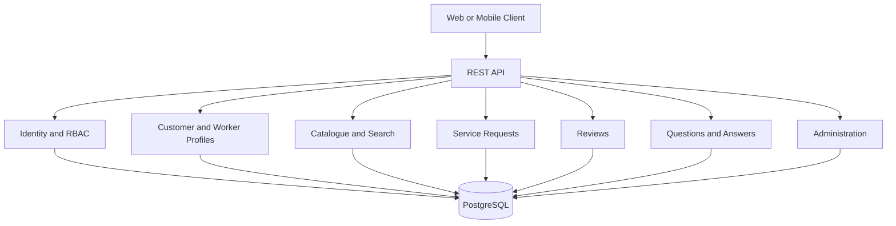
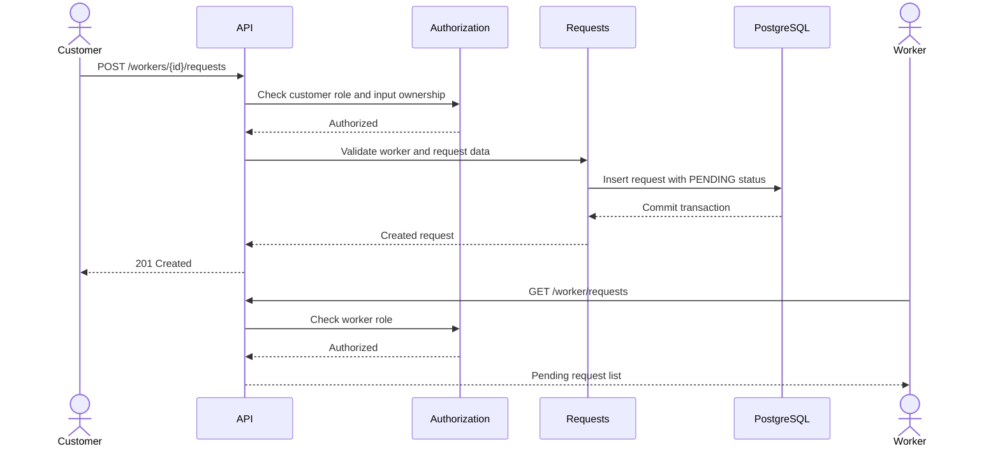

# ADR-001: Adopt a Modular Monolith for RentYourExpert

- **Status:** Accepted
- **Date:** 2026-10-28
- **Decision owners:** RentYourExpert project team
- **Scope:** Initial platform architecture

## Context

RentYourExpert connects customers with workers who provide expert services. The requirements define three roles:

- **Customers** register and log in, manage their profiles, search workers by skill and location, view worker details and reviews, create or delete service requests, ask questions, and create, update, or delete their own reviews.
- **Workers** register and log in, manage their profiles and information, view requests, accept or reject requests, and answer customer questions.
- **Admins** manage customers, workers, requests, reviews, questions, and answers.

The main workflows share identity, ownership, and transactional state. For example, a request belongs to both a customer and a worker, a review should be associated with an eligible customer/request/worker relationship, and question deletion must also handle its answers. Correct authorization and predictable state transitions are therefore more important for the initial version than independent service scaling.

The system is primarily:

| Characteristic | Assessment |
|---|---|
| Workload | Transactional CRUD with workflow state |
| Security | Role-based and resource-ownership authorization |
| Read patterns | Worker catalogue and review browsing |
| Consistency needs | Strong for requests, profiles, reviews, and permissions |
| Distributed-system requirement | Not stated in the requirements |
| Expected initial scale | Suitable for a single deployable application |

## Decision

Implement RentYourExpert as a **modular monolith with a PostgreSQL database** and a REST API.

The application will be deployed as one service but organized into explicit domain modules:



### Module responsibilities

| Module | Responsibilities |
|---|---|
| Identity and RBAC | Registration, login, password hashing, sessions or tokens, roles, authorization policies |
| Profiles | Customer and worker profiles, contact information, worker skills, locations, and profile updates |
| Catalogue and Search | Public worker listings, skill/location filters, worker detail views, and indexed queries |
| Service Requests | Create, list, delete, accept, reject, and validate request state transitions |
| Reviews | Create, read, update, delete, ownership checks, worker review listings, and moderation |
| Q&A | Customer questions, worker answers, visibility rules, and moderated deletion |
| Administration | Privileged customer/worker management, request management, content moderation, and audit records |

The database is the source of truth. Foreign keys, unique constraints, check constraints, and transactions enforce relationships and state integrity.

## Alternatives Considered

### 1. Domain-oriented microservices

Identity, profiles, search, requests, reviews, Q&A, and administration would be separate services, each owning its database and communicating through APIs and events.

**Why it was not selected initially:** it would introduce service discovery, an API gateway, distributed tracing, deployment automation, message-broker operations, cross-service authorization, and eventual-consistency concerns before the requirements justify them. It remains a possible evolution path for a larger platform or multi-team organization.

### 2. Serverless and event-driven backend

An API Gateway and backend-for-frontend would invoke functions for individual use cases. An event bus would support notifications, audit logging, and search-index synchronization.

**Why it was not selected initially:** the approach scales well and minimizes server management, but it makes local development, debugging, retries, event ordering, and end-to-end testing more difficult. The core request and review workflows benefit from direct transactions and a simple operational model.

### 3. Simple layered monolith without domain modules

The application could be implemented as a conventional controller/service/repository structure without explicit domain boundaries.

**Why it was not selected:** it would be easy to start but would make authorization and business rules harder to locate and increase the risk of a tightly coupled codebase. A modular monolith retains the simplicity of one deployment while making future extraction and ownership clearer.

## Consequences

### Positive consequences

- Request status changes and ownership checks can be handled in database transactions.
- Authentication and authorization remain centralized and easier to audit.
- Development, deployment, testing, and debugging are simpler.
- PostgreSQL supports relational integrity between users, profiles, requests, reviews, questions, and answers.
- The architecture is appropriate for the initial project scale.
- Explicit modules preserve a migration path toward services if needed.

### Negative consequences

- All modules share one deployment and may compete for application resources.
- A database or application outage affects the whole platform.
- Teams must actively protect module boundaries to prevent coupling.
- Search cannot scale independently until it is separated or backed by a dedicated index.

## Implementation Notes

### Authentication and authorization

Use secure password hashing and either secure sessions or short-lived access tokens with refresh handling. Every protected operation must check both:

1. **Role permission:** customer, worker, or admin.
2. **Resource ownership:** the authenticated user may modify only resources they own unless an admin policy grants broader access.

Examples:

- Customers may update their own profile, delete their own requests, and modify their own reviews.
- Workers may update their own profile, manage requests assigned to them, and answer questions addressed to them.
- Admins may manage all users and moderate marketplace content.

### Request state machine

The initial request lifecycle should use explicit states:

```text
PENDING -> ACCEPTED
PENDING -> REJECTED
PENDING -> CANCELLED
```

The API must reject invalid transitions and record who performed each transition. A customer may cancel/delete an eligible request, while a worker may accept or reject a pending request.

### Suggested schema

```text
users(id, email, password_hash, role, status, created_at)
customer_profiles(user_id, name, contact_details)
worker_profiles(user_id, bio, location, availability)
skills(id, name)
worker_skills(worker_id, skill_id)
service_requests(id, customer_id, worker_id, description, status, created_at)
reviews(id, customer_id, worker_id, request_id, rating, text, created_at)
questions(id, customer_id, worker_id, text, status, created_at)
answers(id, question_id, worker_id, text, created_at)
audit_events(id, actor_id, action, resource_type, resource_id, created_at)
```

Recommended constraints include unique user emails, foreign keys for all ownership relationships, valid rating ranges, valid request statuses, and a policy preventing duplicate reviews for the same eligible request unless the product explicitly permits updates to one existing review.

### API examples

```text
POST   /auth/register
POST   /auth/login
GET    /workers?skill=&location=
GET    /workers/{workerId}
POST   /workers/{workerId}/requests
GET    /me/requests
DELETE /requests/{requestId}
PATCH  /worker/requests/{requestId}
GET    /workers/{workerId}/reviews
POST   /workers/{workerId}/reviews
PATCH  /reviews/{reviewId}
DELETE /reviews/{reviewId}
POST   /workers/{workerId}/questions
POST   /questions/{questionId}/answers
```

All mutating endpoints should validate input, return explicit errors for unauthorized or invalid operations, and write relevant audit events for administrative actions.

### Request flow



## Future Evolution

The architecture should emit internal domain events even while the system remains a monolith. This allows later extraction without changing every caller.

Recommended extraction order if scale or organizational needs increase:

1. **Catalogue/Search:** move worker discovery to a dedicated search index or service if catalogue reads become dominant.
2. **Notifications:** process request and review events asynchronously for email or in-app notifications.
3. **Reviews/Q&A moderation:** isolate moderation workloads if content volume requires independent scaling.
4. **Service Requests:** extract only when request throughput, availability requirements, or team ownership justify distributed workflow management.

The migration trigger should be measured demand—such as sustained search latency, deployment contention, or team scaling—not architecture preference alone.
